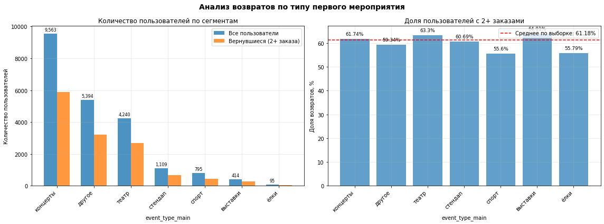
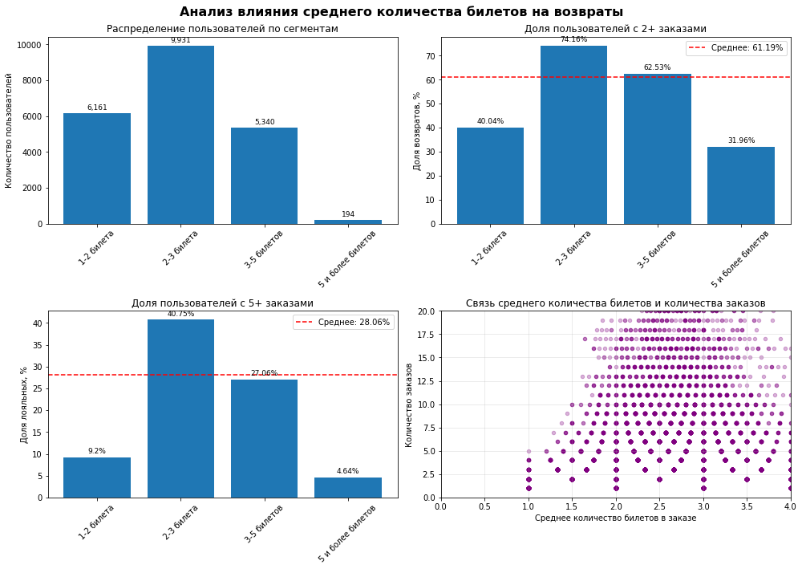

# Анализ лояльности пользователей Яндекс Афиши

Продуктовое исследование поведения пользователей сервиса по продаже билетов на мероприятия. Цель: определить, какие характеристики первого заказа связаны с возвратом пользователя на платформу и как повторные покупки связаны с чеком, количеством билетов и интервалом между заказами.

## Ключевые результаты

| Показатель | Значение |
|---|---|
| Пользователей в выборке | 21 626 |
| Один заказ | 8 393 (38.81%) |
| Два и более заказа | 13 233 (61.19%) |
| Пять и более заказов | 28.06% |

- **Тип первого мероприятия.** Выше среднего доля возвратов у выставок (64.01%), театра (63.30%) и концертов (61.74%); ниже у спорта (55.60%) и «ёлок» (55.79%).
- **Устройство.** С десктопа возвращаются чаще (63.66%), чем с мобильных устройств (60.67%), хотя мобильных пользователей около 83%.
- **Количество билетов.** Наибольшая доля возвратов у пользователей, покупающих в среднем 2-3 билета (74.16%); наименьшая у покупающих 1-2 билета (40.04%) и 5 и более билетов (31.96%).
- **Интервал между заказами.** Среднее число дней между заказами: 10.0 у пользователей с 5 и более заказами против 21.5 у пользователей с 2-4 заказами.
- **День недели первого заказа** влияет слабо: доля возвратов от 59.23% до 62.88%.
- **Корреляции (phik).** Количество заказов умеренно связано со средним количеством билетов (0.231) и средней выручкой (0.226); связь с устройством и оператором слабая (не более 0.09).





### Проверка гипотез

1. *Пользователи, начавшие со спортивных мероприятий, возвращаются чаще, чем начавшие с концертов.* Не подтвердилась: 55.60% против 61.74%.
2. *В регионах с наибольшим числом пользователей доля повторных заказов выше.* Подтверждается лишь слабо: в 25 наиболее активных регионах доля возвратов 61.71%, в остальных 56 регионах 56.31% (z-тест для пропорций, p < 0.001). Однако корреляция размера региона и доли возвратов слабая (r = 0.12), а z-тест по объединённым группам не учитывает различия между регионами внутри группы. Надёжный вывод требует модели с учётом кластеризации по регионам.

### Бизнес-рекомендации

- Поощрять клиентов с частыми заказами (программы лояльности, бонусы за повторные покупки).
- Уделять внимание клиентам с большим средним чеком и 2-3 билетами в заказе: в этих сегментах самая высокая доля возвратов.
- При привлечении новых пользователей делать упор на мероприятия с высокой долей возвратов (выставки, театр, концерты); для спорта и «ёлок» разработать отдельные механики удержания.

## Данные

Данные загружаются из PostgreSQL (схема `afisha`, таблицы `purchases`, `events`, `city`, `regions`) и в репозиторий не включены. Курс тенге берётся из публичного CSV, адрес указан в ноутбуке. Результаты выполнения сохранены в выводах ячеек.

Исходные поля: идентификатор пользователя и заказа, тип устройства, время заказа, валюта, выручка, количество билетов, дни с предыдущей покупки, мероприятие, тип мероприятия, билетный оператор, город и регион. Из выборки исключены заказы на фильмы и устройства, отличные от `mobile` и `desktop`.

## Методология

1. **Загрузка данных** SQL-запросом с расчётом интервала между заказами оконной функцией `LAG`.
2. **Предобработка.** Приведение выручки к рублям (курс тенге по дате заказа), оптимизация типов, удаление технических дубликатов (заказы с одинаковой суммой и временем в пределах одной минуты) и записей с отрицательной выручкой, фильтрация выручки по 99-му перцентилю.
3. **Профиль пользователя.** Агрегация до одной строки на пользователя: первый и последний заказ, число заказов, средняя выручка, среднее число билетов, средний интервал между заказами, признаки первого заказа; бинарные признаки «2+ заказа» и «5+ заказов». Число заказов отфильтровано по 99-му перцентилю.
4. **Исследовательский анализ.** Точки входа, доли возвратов по сегментам, сравнение распределений выручки между группами, временные характеристики первого заказа.
5. **Статистическая проверка.** Z-тест для пропорций и t-тест Уэлча.
6. **Корреляционный анализ** коэффициентом phik.

## Структура репозитория

```
.
├── notebooks/
│   └── afisha_user_loyalty_analysis.ipynb   # полный анализ
├── reports/figures/                          # графики для README
├── .env.example                              # шаблон параметров подключения к БД
├── requirements.txt
├── LICENSE
└── README.md
```

## Запуск

```bash
git clone <URL репозитория>
cd afisha-user-loyalty-analysis

python -m venv .venv
source .venv/bin/activate        # Windows: .venv\Scripts\activate
pip install -r requirements.txt

cp .env.example .env             # заполните параметры подключения к PostgreSQL
jupyter lab notebooks/afisha_user_loyalty_analysis.ipynb
```

Для повторного выполнения ноутбука необходим доступ к базе данных.

## Ограничения

- Сохранённые выводы отдельных ячеек получены при разных запусках (например, 21 610 пользователей после фильтрации в разделе 3.2 и 21 626 в разделе 4). Перед публикацией новых результатов рекомендуется выполнить ноутбук целиком (Restart and Run All).
- Тест по гипотезе 2 нарушает предпосылки независимости и однородности дисперсий, поэтому результат следует считать предварительным.

## Технологии

Python, pandas, NumPy, SciPy, statsmodels, phik, matplotlib, seaborn, SQLAlchemy, PostgreSQL, Jupyter.

## Автор

Перепелюк Иван Александрович. Лицензия: [MIT](LICENSE).
